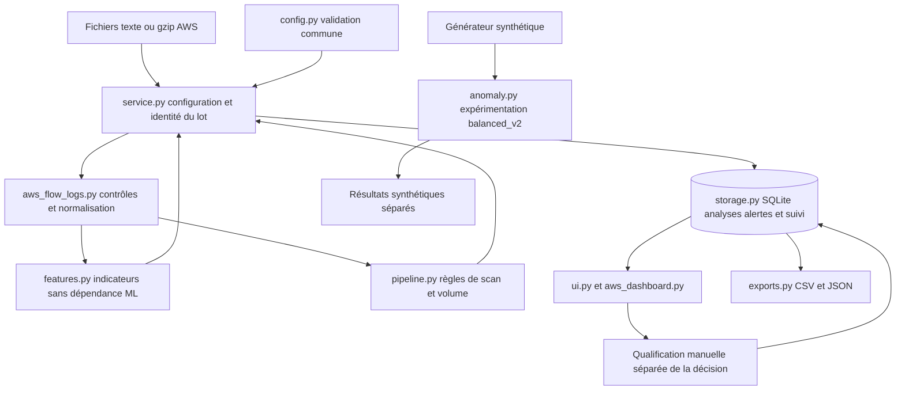

# Architecture du socle V1

Le moteur reste local et hors ligne. Les fichiers AWS sont téléchargés manuellement. Les analyses AWS et les expériences synthétiques portent des provenances distinctes.

La CLI python -m smart_ids et le mode AWS de Streamlit utilisent AnalysisConfig et analyze_aws. Une analyse fige la configuration et la version du moteur. Son identité combine les empreintes et noms des fichiers, triés, la provenance, la configuration canonique et la version du moteur. Le même lot dans un autre ordre est retrouvé ; une autre configuration produit une nouvelle analyse. Des fichiers différents ou des compressions différentes constituent d'autres lots. Le dédoublonnage sémantique entre captures partiellement recouvrantes reste hors périmètre.

SQLite conserve les tables analyses, alerts et followups. La table analyses garde des instantanés JSON des événements, fenêtres et diagnostics avec les noms de colonnes. C'est un choix de simplicité pour les lots bornés du prototype ; il n'est pas conçu pour des millions de lignes ou des recherches distribuées. Une analyse et ses alertes sont insérées dans une transaction ; l'identité unique protège le réimport concurrent. Une qualification met à jour l'état et ajoute une ligne de suivi, sans modifier decision_json.

Chaque flux retenu reçoit un event_id local à l'analyse. Les décisions des règles conservent la liste de ces références, ce qui permet de retrouver exactement les lignes ayant contribué aux ports distincts ou aux octets sortants. Les labels/scénarios synthétiques ne sont pas utilisés pour la décision.

L'historique filtre d'abord par provenance. Les alertes se filtrent par hôte, détecteur, statut et période UTC. Les exports portent les métadonnées et distinguent le téléchargement des seules alertes filtrées de celui de l'analyse complète.

La base par défaut est var/smart_ids.sqlite3, hors Git. SMART_IDS_DB permet de choisir un autre chemin local. Pour effacer les captures et commentaires persistés, arrêter l'application et supprimer cette base et ses éventuels fichiers compagnons, après export des preuves utiles. Les exports sont à conserver dans un répertoire privé. Aucune clé ou connexion AWS n'est stockée.

Les cinq vues de conception et le cahier des charges approuvé sont conservés dans docs/specification.md et docs/diagrammes_conception.md. Le modèle conceptuel pourra être normalisé en tables événement/fenêtre si le volume du projet augmente.
