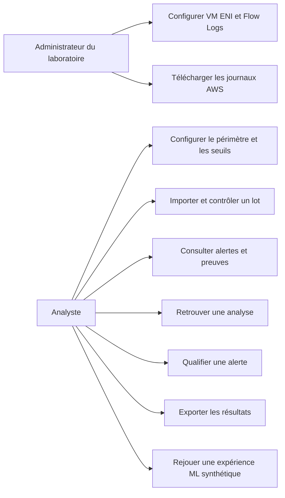
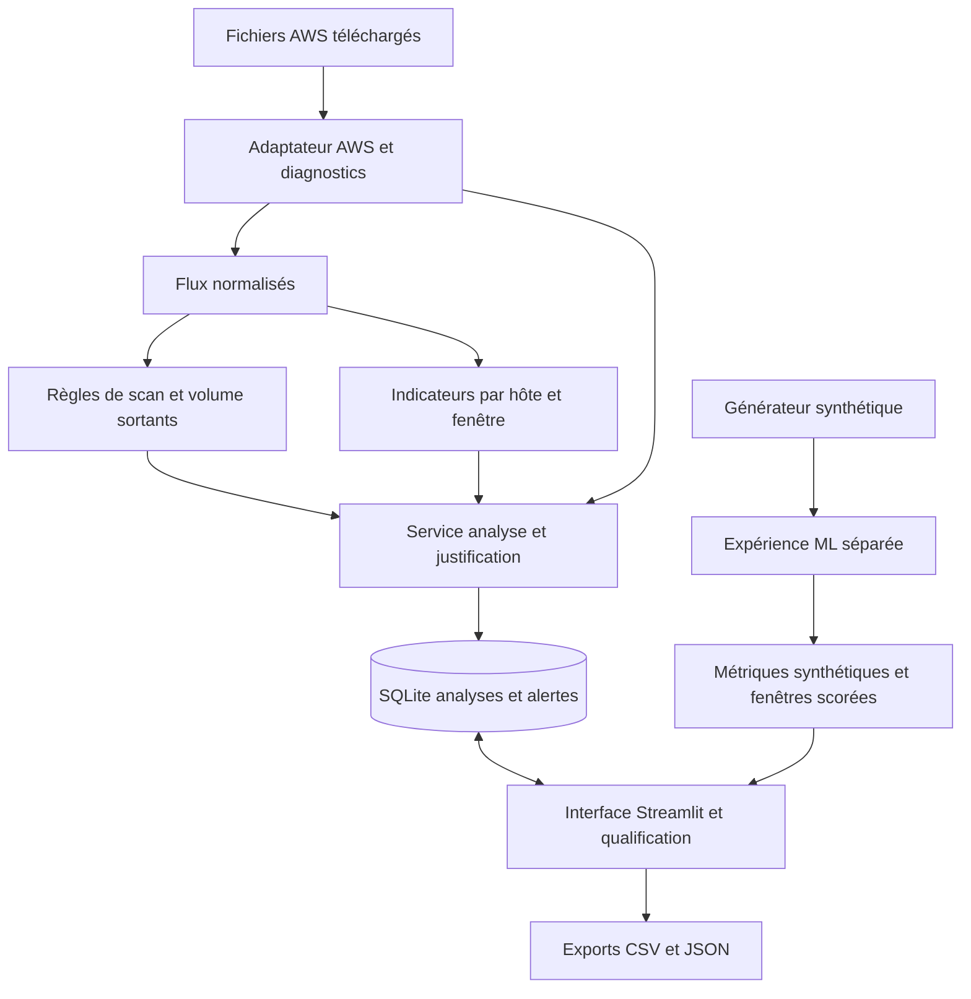
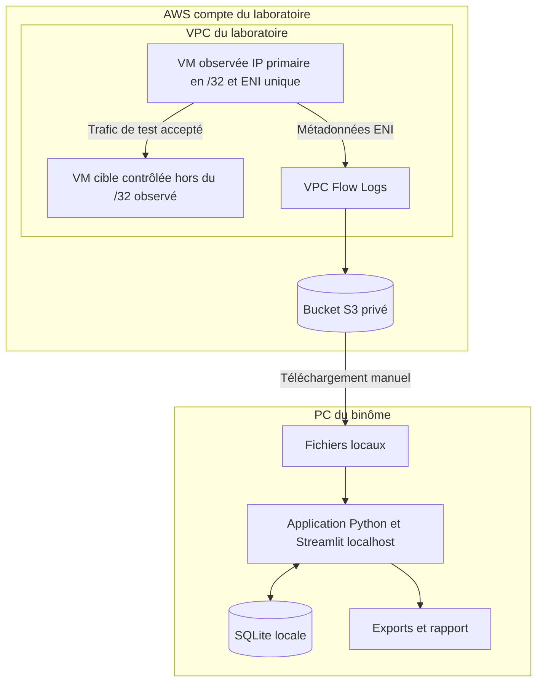
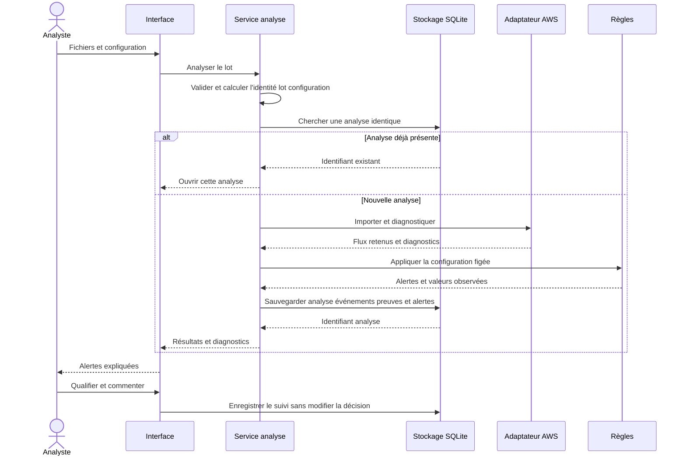
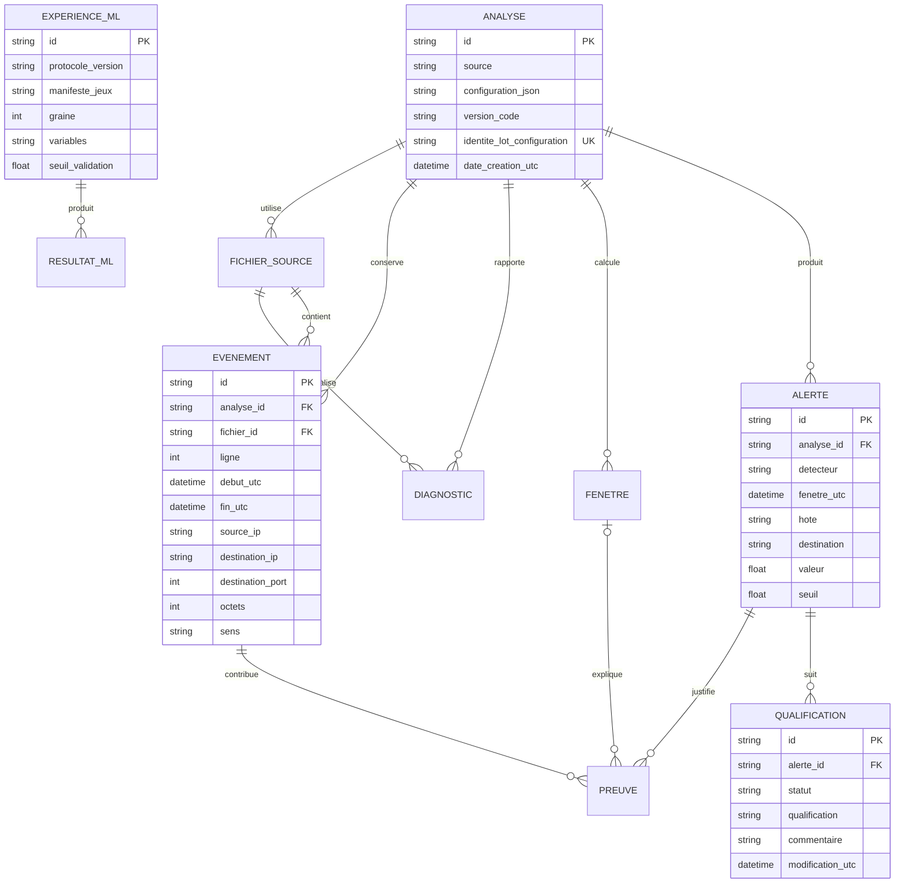

# Diagrammes de conception Smart IDS pour AWS

Version cible V1 du 7 novembre 2026. Ces vues accompagnent le cahier des charges. Les blocs SQLite, service d'analyse et qualification représentent des ajouts à réaliser ; les détecteurs et l'import AWS existent déjà. Le ML reste synthétique dans le socle.

## 1 Cas utilisation

## 2 Composants

## 3 Déploiement

La cible peut être dans le même VPC tout en étant hors du périmètre logique observé. Cette V1 ne nécessite ni NAT comme point de capture, ni service d'analyse exposé sur Internet.

## 4 Séquence import et alerte

## 5 Modèle de données

Le modèle est conceptuel : les champs complets, index, types SQLite et contraintes seront définis dans le ticket L01. Une preuve référence un événement ou une fenêtre. Une contrainte de cohérence devra garantir qu'au moins une de ces références est renseignée. Les expériences ML sont conservées à part des analyses AWS.
