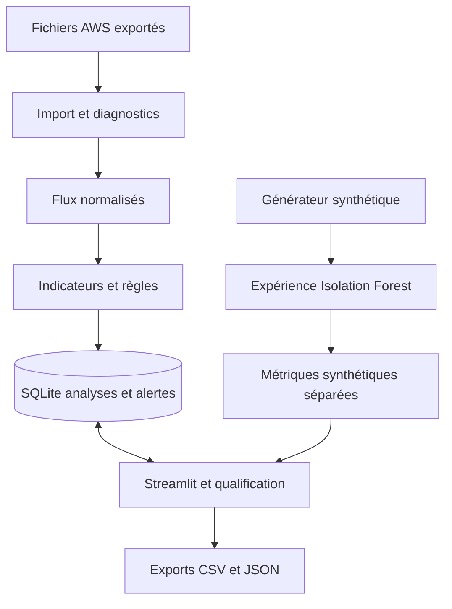
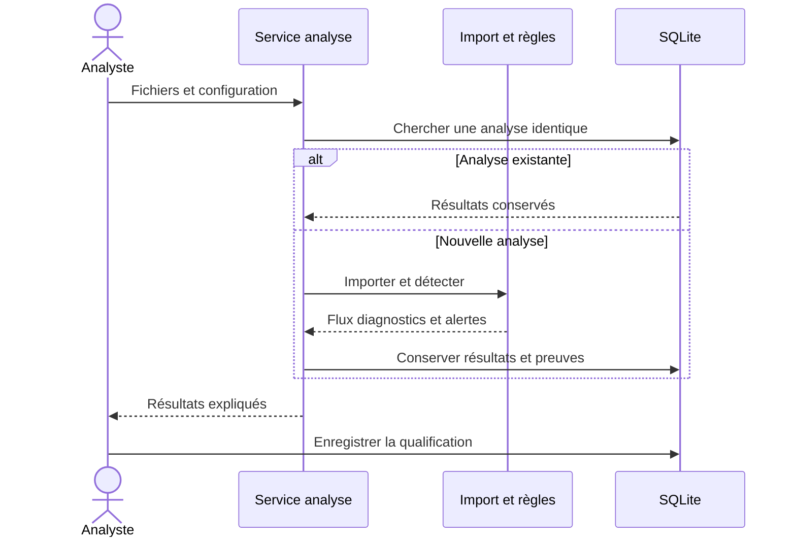

# Cahier des charges Smart IDS pour AWS

Version 1.1 - 7 novembre 2026

Équipe de réalisation : Adam et Mahmoud. Durée disponible : environ deux mois. Cible de travail : quatre semaines pour le socle, puis corrections et rapport. Référence technique examinée : dépôt ELHAMI-Mahmoud/smart-ids-for-cloud, commit b693b369451c3b747c4ff8794fab505b531e416c.

## 1 Objectif et résultat attendu

Nous réaliserons un prototype étudiant d'IDS qui analyse des journaux de flux réseau AWS, signale des comportements suspects et permet de consulter les éléments ayant motivé chaque alerte. L'application fonctionnera localement à partir de fichiers exportés d'AWS. Elle comportera également une expérience reproductible de détection d'anomalies avec Isolation Forest.

Le résultat attendu est une démonstration complète : importer un lot de journaux, contrôler sa qualité, détecter un scan sortant ou un volume sortant élevé, consulter les preuves, conserver l'analyse et qualifier les alertes. Un deuxième parcours présentera l'expérience intelligente sur données synthétiques, ses résultats et ses limites.

La V1 sera un IDS d'analyse différée. Le module intelligent synthétique ne sera pas présenté comme un modèle validé sur AWS. L'analyse continue et l'apprentissage sur un comportement réel AWS feront l'objet d'une extension distincte.

Ce document fixe le périmètre de travail du binôme. Il ne constitue pas une validation de l'encadrant. Il permet de poursuivre avec des décisions explicites et de lui présenter ultérieurement un résultat cohérent.

## 2 Périmètre retenu

| Sujet | Décision pour la V1 |
|---|---|
| Plateforme | AWS uniquement |
| Source principale | VPC Flow Logs texte standard v2, éventuellement gzip |
| Collecte | Configuration AWS et téléchargement manuels, puis import local |
| Ressources observées | Une VM Linux, une seule interface réseau ENI, IP primaire connue |
| Périmètre logique | Adresse de la VM observée en /32 pour IPv4, déclarée explicitement |
| Cible des essais | Une autre machine contrôlée, extérieure au /32 observé, éventuellement dans le même VPC |
| Flux analysés | TCP/UDP ACCEPT franchissant le périmètre logique |
| Temps | Fenêtres fixes UTC de cinq minutes |
| Détections à règles | Scan sortant et volume sortant élevé |
| Module intelligent | Expérience synthétique séparée, entraînement et évaluation reproductibles |
| Interface | Streamlit local, utilisateur unique |
| Persistance à ajouter | SQLite pour analyses, configuration, alertes et qualifications |

« Sortant » signifie ici quitter le périmètre déclaré, pas nécessairement quitter AWS ou rejoindre Internet. Avec une IP observée en /32, une autre VM privée du VPC peut servir de cible contrôlée.

Les scans entrants, les scans entièrement refusés par les règles réseau, les échanges entre deux hôtes du périmètre et les protocoles autres que TCP/UDP ne sont pas couverts par les règles de cette V1. Leurs exclusions doivent être visibles. Les flux ne permettent pas d'observer les mots de passe SSH ni le contenu applicatif.

## 3 Utilisateurs et parcours

Le binôme assure deux rôles : administrateur du laboratoire et analyste des résultats. Une personne peut exercer les deux rôles ; aucune gestion multiutilisateur n'est requise pour l'application locale.

Le parcours AWS est le suivant : choisir les fichiers, déclarer le /32 et l'ENI, vérifier les diagnostics, lancer l'analyse, consulter les alertes et leurs preuves, qualifier les alertes, puis exporter les résultats. Après redémarrage, l'utilisateur retrouve les analyses enregistrées.

Le parcours synthétique permet de rejouer une démonstration déterministe et l'expérience Isolation Forest. Le type des données est toujours visible. Les résultats synthétiques et AWS ne sont jamais mélangés dans un même tableau de performances.

## 4 Fonctions obligatoires

Toutes les fonctions F01 à F11 appartiennent au socle. Leur état actuel est détaillé dans le plan d'adaptation joint. La section 10 de ce cahier attribue nominativement les tâches restantes à Adam et Mahmoud, à partir du dépôt de Mahmoud.

### F01 Configurer une analyse

L'utilisateur doit définir le périmètre CIDR, une ENI, les seuils des deux règles et la politique des intervalles qui traversent plusieurs fenêtres. La durée des fenêtres reste fixée à cinq minutes en V1. Une configuration invalide est refusée avec un message compréhensible. Chaque analyse conserve une copie et une version de sa configuration.

### F02 Importer et contrôler les journaux

L'application doit accepter les fichiers texte UTF-8 .log ou .txt, éventuellement .gz. Le format standard v2 est obligatoire ; le format personnalisé déjà disponible peut être conservé. Les limites sont de 20 Mio par fichier compressé ou décompressé et 50 Mio décompressés pour le lot.

Les contrôles portent sur les champs obligatoires, les adresses, les ports, les compteurs, l'ordre temporel, l'ENI et les doublons exacts dans le lot. Les états NODATA, SKIPDATA, REJECT et les exclusions sont affichés séparément. Une valeur absente n'est pas remplacée arbitrairement par zéro. Un lot sans flux utilisable ne provoque pas de plantage.

### F03 Normaliser et calculer les indicateurs

Les événements doivent conserver leurs dates de début et de fin, leur provenance, le fichier et le numéro de ligne. Les dates sont converties en UTC. Les indicateurs sont calculés par hôte et fenêtre de cinq minutes : nombre d'enregistrements retenus, ports et destinations distincts en sortie, maximum de ports par destination, octets sortants et octets entrants lorsque ce sens est observé.

Le nombre d'enregistrements n'est pas présenté comme un nombre exact de connexions. Les totaux décrivent les lignes retenues ; les pertes et exclusions restent consultables.

### F04 Détecter un scan sortant

Pour chaque fenêtre et paire source/destination, le moteur doit comparer le nombre de ports destination distincts au seuil configuré. Une alerte indique la source, la destination, la période, la valeur, le seuil et les événements justificatifs. Le seuil initial est de 20 ports, comparaison inclusive. Il s'agit d'une suspicion de reconnaissance, pas d'une preuve d'intrusion.

### F05 Détecter un volume sortant élevé

Pour chaque fenêtre et hôte source, le moteur doit additionner les octets sortants retenus, toutes destinations confondues, puis les comparer au seuil. Le seuil initial est de 50 000 000 octets, soit 50 Mo décimaux, comparaison inclusive. Une sauvegarde légitime peut déclencher cette règle ; la qualification par l'utilisateur reste nécessaire.

### F06 Présenter et expliquer les résultats

Le tableau de bord doit présenter les diagnostics d'import, les indicateurs et la liste des alertes. Des filtres permettent de choisir une analyse, une période, un hôte, un détecteur et un statut. Le détail d'une alerte affiche les valeurs observées, la configuration et les lignes ou fenêtres ayant contribué à la décision.

L'absence d'alerte est formulée comme « aucune alerte parmi les données retenues ». Les compteurs de pertes ou d'exclusions restent visibles.

### F07 Exécuter le module intelligent expérimental

Le mode synthétique doit permettre de générer les données de manière déterministe, d'entraîner Isolation Forest sur le normal d'entraînement, de choisir le seuil sur validation et de comparer règles seules, modèle seul et combinaison OU. Les périodes et instances sont disjointes ; les étiquettes, adresses IP et identifiants ne sont pas des entrées du modèle.

Les résultats comprennent précision, rappel, F1, taux de faux positifs et matrice de confusion. Le score est présenté comme un score d'anomalie non probabiliste. Les valeurs des indicateurs constituent les éléments observés ; aucune explication causale du modèle n'est inventée.

Le test exploratoire déjà consulté reste identifié comme tel. Avant une évaluation finale, l'équipe écrit et gèle le protocole, le code et les seuils, puis utilise un jeu final réellement réservé et archivé avec son manifeste. Une amélioration de score n'est pas une condition de réussite du logiciel ; la comparaison honnête est obligatoire.

### F08 Conserver un historique fiable

L'application doit conserver localement les analyses, les empreintes des fichiers, les configurations, les diagnostics, les fenêtres analysées et les alertes. Après redémarrage, ces éléments sont consultables. Les événements ou références nécessaires à la justification sont conservés avec l'analyse.

Réimporter exactement le même lot avec la même configuration doit ouvrir l'analyse existante ou empêcher sa duplication. Une configuration différente crée une analyse distincte. La V1 ne fusionne pas automatiquement des captures partiellement recouvrantes entre lots.

### F09 Qualifier et suivre une alerte

Une alerte possède un statut Nouveau, En cours ou Clôturé. L'utilisateur peut ajouter une qualification : Non déterminé, Activité légitime ou Suspect à examiner, ainsi qu'un commentaire. La date des modifications est conservée. Une qualification manuelle ne change ni la décision d'origine ni les étiquettes du jeu d'évaluation.

### F10 Exporter une analyse

L'utilisateur doit pouvoir exporter les alertes, les diagnostics et les indicateurs en CSV, ainsi que les paramètres et métadonnées en JSON. Les exports indiquent la provenance, la période UTC, les seuils, la politique temporelle et la version du traitement. Les champs libres destinés à un tableur doivent être exportés sans permettre leur interprétation comme formule.

### F11 Démontrer le fonctionnement sur AWS

Le binôme doit réaliser au moins une capture provenant réellement de son laboratoire AWS et rejouer le parcours complet. Le dossier de preuve comporte la configuration de collecte, la période, les ressources observées, des extraits anonymisés et le journal des scénarios exécutés.

L'obtention de fichiers AWS réels valide l'intégration ; elle ne suffit pas à établir la précision ou le rappel. Ces métriques exigent un protocole avec vérité terrain indépendante. Si l'accès AWS manque, le livrable doit porter la mention « laboratoire local avec import AWS compatible, intégration réelle non validée » et F11 reste non acquise.

## 5 Décisions de détection

| Détecteur | Unité de décision | Condition initiale | Motif présenté |
|---|---|---|---|
| R01 Scan sortant | Source et destination dans cinq minutes | Au moins 20 ports distincts | Multiplicité de ports contactés |
| R02 Volume sortant | Hôte source dans cinq minutes | Au moins 50 000 000 octets | Volume observé supérieur au seuil |
| M01 Isolation Forest | Hôte dans cinq minutes, données synthétiques | Score au moins égal au seuil de validation | Fenêtre atypique selon le modèle |

Les deux seuils de règles sont des valeurs initiales reprises du prototype, pas des normes de sécurité. Leur réglage se fait sur développement et validation, avec des activités légitimes représentatives. Les valeurs doivent être figées avant l'évaluation finale.

Pour AWS, le timestamp d'analyse est la fin de l'enregistrement. La politique par défaut exclut les intervalles traversant plusieurs fenêtres et les compte au diagnostic. L'option « fin » affecte tout l'enregistrement à la fenêtre de fin et affiche explicitement cette approximation. Aucun découpage proportionnel ni duplication des octets n'est inventé.

AWS agrège les flux et les publie avec un délai de livraison variable [S2]. L'application ne promet donc pas une alerte instantanée. Les délais fournisseur et traitement local sont distingués.

## 6 Architecture et conception

L'application comporte un adaptateur AWS, un traitement commun des flux, des détecteurs, un stockage local et une interface. Le générateur synthétique et l'expérience ML utilisent une branche séparée. Le moteur reçoit des données normalisées ; il ne dépend pas directement de l'interface Streamlit.

Le stockage SQLite est l'ajout principal de structure. Un module de service coordonne l'import, l'analyse et la sauvegarde. Les modules actuels de détection et d'import sont conservés. Le détail des composants cibles figure dans le plan d'adaptation.

Le fichier diagrammes_conception.md fournit les sources Mermaid de cinq vues : cas d'utilisation, composants, déploiement, séquence et modèle de données. Ces diagrammes décrivent la cible V1 ; la présence d'une boîte ne signifie pas que le composant existe déjà.

## 7 Données à conserver

| Objet | Informations minimales |
|---|---|
| Analyse | Identifiant, provenance, date, version du code, statut, configuration figée |
| Fichier source | Nom, empreinte SHA-256, taille, lien avec l'analyse |
| Diagnostic | Fichier, ligne, état, motif et compteurs rapportés |
| Événement normalisé | Période, source, destination, ports, protocole, octets, sens, provenance |
| Fenêtre | Hôte, début UTC, durée et indicateurs calculés |
| Alerte | Détecteur/version, période, hôte, destination éventuelle, valeur, seuil, références justificatives |
| Qualification | Alerte, statut, qualification, commentaire, date de modification |
| Expérience ML | Version du générateur, graine, variables, paramètres, seuil, manifeste des jeux et métriques |

Chaque alerte appartient à une analyse. Une alerte référence des événements ou une fenêtre et sa configuration. Les expériences ML conservent leurs résultats séparément des analyses AWS. Les données synthétiques sont identifiées explicitement ; une provenance AWS déclarée n'est pas une preuve d'authenticité du fichier.

## 8 Exigences de qualité et exploitation

| Identifiant | Exigence et vérification |
|---|---|
| Q01 Exactitude | Vérifier les frontières temporelles, seuils inclusifs, sens des flux, unités et doublons |
| Q02 Robustesse | Un fichier vide, invalide ou trop volumineux produit un résultat explicite et ne corrompt pas l'historique |
| Q03 Reproductibilité | Mêmes données, configuration et versions : mêmes décisions ; conserver les empreintes et paramètres |
| Q04 Performance | Objectif proposé : analyser 10 000 lignes valides en moins de 30 secondes, apprentissage exclu, sur le PC identifié dans le rapport ; résultat à mesurer |
| Q05 Accès | Interface liée à localhost pour cette V1 ; pas d'exposition publique sans nouvelle conception d'accès |
| Q06 Données | Journaux, base et secrets exclus de Git ; exports anonymisés pour le rapport ; suppression locale documentée |
| Q07 Cloud | Bucket privé, permissions limitées aux tâches de collecte et de lecture, budget fixé par le binôme avant lancement, ressources arrêtées ou supprimées après les essais |
| Q08 Portabilité | Environnement Python documenté et versions vérifiées sur le système réellement utilisé ; préserver les fins de ligne des fichiers hachés |

Le prototype réutilise Python, pandas, scikit-learn et Streamlit. SQLite est ajouté pour l'historique. Le développement « from scratch » porte sur le schéma, les traitements, la logique de décision, la traçabilité et l'évaluation, tout en utilisant ces bibliothèques comme briques techniques.

## 9 Recette et critères de fin

Chaque test produit une preuve : commande ou action effectuée, configuration, résultat attendu et résultat obtenu. Les tests sur données construites valident un comportement logiciel ; ils ne prouvent pas une performance réelle de détection.

| Test | Exigences | Résultat attendu |
|---|---|---|
| T01 Import standard et gzip | F01 F02 | Mêmes flux normalisés pour les mêmes enregistrements |
| T02 Données invalides et pertes | F02 Q02 | Motifs visibles, aucune valeur inventée, aucun plantage |
| T03 Doublons dans un lot | F02 F03 | Une seule occurrence contribue aux compteurs |
| T04 Frontières UTC et sens | F03 Q01 | Groupes attendus, entrants non assimilés aux sortants |
| T05 Règle de scan | F04 | 19 ports sans alerte, 20 avec alerte, justification exacte |
| T06 Règle de volume | F05 | 49 999 999 octets sans alerte, 50 000 000 avec alerte |
| T07 Intervalles entre fenêtres | F01 F03 | Exclusion ou affectation à la fin conforme au choix, avertissement visible |
| T08 Historique et réimport | F08 | Résultats retrouvés après redémarrage, lot identique non dupliqué |
| T09 Qualification | F09 | Statut/commentaire conservés, décision initiale intacte |
| T10 Filtres et exports | F06 F10 | Sélection correcte, exports cohérents avec l'analyse et sa provenance |
| T11 Expérience intelligente | F07 Q03 | Reproductibilité, jeux séparés, calculs vérifiés, limites affichées |
| T12 Laboratoire AWS | F11 | Capture réelle, import et analyse reproductibles ; preuve des scénarios |
| T13 Activité légitime volumineuse | F05 F09 | Limite de la règle observée et alerte qualifiable comme légitime |
| T14 Performance locale | Q04 | Temps et machine mesurés ; écart à l'objectif expliqué |

Le socle est terminé lorsque F01 à F11 sont démontrées, les tests correspondants sont documentés, les défauts bloquants sont corrigés et une autre personne peut reproduire la démonstration avec le guide d'installation. Q04 est un objectif mesuré et les résultats de détection sont rapportés sans seuil de précision arbitraire imposé après observation.

Pour une évaluation de détection, publier TP, FP, TN, FN ainsi que précision = TP/(TP+FP), rappel = TP/(TP+FN), F1 et FPR = FP/(FP+TN). Indiquer le nombre de fenêtres et la proportion de suspects. Un dénominateur nul est traité explicitement. Les résultats synthétiques, de validation, exploratoires et finaux portent des libellés distincts.

## 10 Répartition des tâches entre Adam et Mahmoud

### 10.1 Point de départ et responsabilités

Le point de départ commun est le dépôt de Mahmoud ELHAMI-Mahmoud/smart-ids-for-cloud, dans la version b693b369451c3b747c4ff8794fab505b531e416c examinée. Le générateur synthétique, les deux règles, l'import AWS, les vues Streamlit et l'expérience Isolation Forest constituent le travail préexistant de Mahmoud. Ils sont réutilisés. Les lots ci-dessous portent sur les compléments, l'intégration et la validation de ce socle.

Mahmoud pilote le moteur d'analyse, les données, les règles et le module intelligent. Adam pilote la persistance, le suivi des alertes, l'interface et le laboratoire AWS. Chacun écrit les tests de sa partie et fait relire ses changements par l'autre. La conception du contrat des données et la recette finale sont communes.

Cette répartition tient compte du travail déjà livré par Mahmoud et confie à Adam un ensemble de nouvelles fonctions identifiable. Les rôles de pilote fixent qui doit livrer ; l'autre membre participe à la revue et peut aider sur un blocage.

### 10.2 Attribution des fonctionnalités

| Fonctions | Pilote | Travail restant attribué |
|---|---|---|
| F01 Configuration | Mahmoud | Valider les paramètres dans un objet commun et les transmettre au moteur. Adam réalise la saisie et l'affichage de la configuration dans Streamlit. |
| F02 Import | Mahmoud | Consolider les diagnostics, les cas vides et les limites ; conserver l'adaptateur existant et ses conventions. |
| F03 Indicateurs | Mahmoud | Extraire l'agrégation dans un module indépendant du ML et vérifier fenêtres UTC, sens et compteurs. |
| F04 Scan sortant | Mahmoud | Conserver la règle, appliquer la configuration commune et fournir les références des flux justificatifs. |
| F05 Volume sortant | Mahmoud | Conserver la règle, fournir sa justification et tester les activités légitimes volumineuses. |
| F06 Consultation | Adam | Ajouter choix d'analyse, filtres, vue détaillée et preuves ; raccorder les vues existantes au service d'analyse et à SQLite. |
| F07 Module intelligent | Mahmoud | Stabiliser le protocole, couvrir les familles normales, analyser les erreurs et conserver les résultats synthétiques séparés. Adam vérifie leur présentation dans l'interface. |
| F08 Historique | Adam | Concevoir et implémenter SQLite, les opérations de lecture et d'écriture et la réouverture après redémarrage. Mahmoud réalise l'identité lot/configuration et le service qui utilise ce stockage. |
| F09 Qualification | Adam | Ajouter statut, qualification, commentaire et dates, avec sauvegarde et consultation dans l'interface. |
| F10 Export | Adam | Compléter les CSV et les métadonnées JSON à partir des analyses enregistrées. Mahmoud vérifie la cohérence des valeurs et paramètres du moteur. |
| F11 Laboratoire AWS | Adam | Préparer VM, ENI, Flow Logs, S3 et exports manuels ; documenter la capture. Mahmoud prépare les scénarios de détection et vérifie leur interprétation avec Adam. |

### 10.3 Contrat commun avant développement parallèle

Adam et Mahmoud consacrent le premier jalon à un exemple partagé d'analyse, de configuration, d'événement et d'alerte. Adam propose les identifiants et relations nécessaires au stockage ; Mahmoud fournit les champs réellement produits par l'import et les détecteurs. Ils fixent ensemble les types, noms, dates UTC et références des preuves.

Le contrat doit notamment préciser : l'entrée du service d'analyse, le résultat renvoyé à l'interface, l'identité stable d'un lot et de sa configuration, ainsi que les opérations du stockage. Un exemple JSON validé par les deux et un schéma des relations constituent la preuve de fin de ce jalon. Les deux branches de développement utilisent ensuite ce même exemple.

### 10.4 Lots de travail restants

L01 Contrat et reprise du dépôt. Adam et Mahmoud installent la même référence du dépôt et reproduisent la démonstration. Mahmoud explique les conventions de données et remet la procédure de reproduction. Adam vérifie l'installation sur son poste. Le contrat décrit en 10.3 est ensuite fixé. Les fichiers de baseline sont conservés.

L02 Moteur et configuration, piloté par Mahmoud. Mahmoud termine F01 à F05 : configuration partagée, extraction des indicateurs, diagnostics et liens vers les preuves. Il fournit un résultat structuré consommable par le stockage et l'interface. La fin du lot est vérifiée par T01 à T07 et par un exemple d'alerte justifiée relu par Adam.

L03 Stockage et qualification, piloté par Adam. Après L01, Adam crée le schéma SQLite et les opérations pour enregistrer une analyse, ses sources, diagnostics, fenêtres, alertes et qualifications. Il fournit les appels nécessaires à Mahmoud pour L04. La fin du lot exige une lecture après redémarrage et une qualification persistante, avec T08 et T09.

L04 Service d'analyse, piloté par Mahmoud avec Adam. Mahmoud coordonne validation, import, indicateurs, règles et identité du lot. Il appelle le stockage développé par Adam. Le service ouvre une analyse identique existante ou enregistre la nouvelle analyse et ses preuves. Adam vérifie les transactions et la réouverture depuis l'interface. T08 couvre leur intégration.

L05 Interface et exports, piloté par Adam. Adam adapte les vues Streamlit existantes pour appeler le service, retrouver les analyses, filtrer les alertes et consulter leurs détails. Il ajoute les actions de qualification et les exports de F10. La fin du lot correspond au parcours complet de consultation, qualification, redémarrage et export, vérifié par T09 et T10.

L06 Expérience intelligente et reproductibilité, piloté par Mahmoud. Mahmoud corrige la sélection des familles normales dans le générateur, conserve la référence historique, documente le nouveau protocole et fige les paramètres avant le test final. Il traite aussi les versions d'environnement et les fins de ligne des fichiers hachés. Adam relit le protocole et vérifie que l'interface distingue les résultats synthétiques des imports AWS. T11 valide ce lot.

L07 Laboratoire réel et performance, piloté par Adam avec Mahmoud. Adam configure le laboratoire, relève le /32 et l'ENI, récupère les fichiers et consigne les périodes. Mahmoud définit les scénarios normal, scan sortant et volume sortant, ainsi que les résultats attendus des règles. Ils exécutent les essais ensemble ; Adam rassemble les preuves et mesure le temps de traitement, Mahmoud vérifie les compteurs et explique les exclusions. T12 à T14 valident ce lot.

L08 Dossier et recette finale, réalisé par Adam et Mahmoud. Chaque membre rédige les parties correspondant à son travail puis fait reproduire sa procédure par l'autre. Ils remplissent le tableau de recette T01 à T14, corrigent les défauts bloquants et préparent une démonstration commune. Les limites observées et les fonctions non acquises sont indiquées explicitement.

L02 et L03 peuvent avancer en parallèle dès la fin de L01. L04 nécessite le contrat et les opérations de stockage de L03 ; L05 peut être préparé sur l'exemple commun avant le raccordement final à L04. L06 et la préparation AWS de L07 peuvent avancer pendant l'intégration. Les essais complets de L07 et L08 utilisent une chaîne raccordée.

### 10.5 Attribution de la recette

| Tests | Responsable de l'exécution | Relecture ou contribution |
|---|---|---|
| T01 à T07 Import et règles | Mahmoud | Adam reproduit les cas et vérifie leur présentation dans l'interface. |
| T08 Historique et réimport | Adam | Mahmoud fournit le service et l'identité du lot ; les deux vérifient l'absence de duplication. |
| T09 et T10 Suivi et exports | Adam | Mahmoud vérifie les décisions initiales et les valeurs exportées. |
| T11 Expérience intelligente | Mahmoud | Adam relit le protocole et reproduit la commande d'évaluation prévue. |
| T12 et T13 Laboratoire et cas légitime | Adam | Mahmoud prépare les scénarios et interprète les décisions des règles. |
| T14 Performance locale | Adam | Mahmoud analyse et corrige les ralentissements du moteur si nécessaire. |

Pour Q01 à Q03, Mahmoud pilote l'exactitude du moteur et la reproductibilité ML ; Adam pilote la robustesse de l'historique et de l'interface. Adam pilote la mesure Q04 et les exigences d'accès et de données Q05 à Q07. Mahmoud documente l'environnement Q08, puis Adam vérifie l'installation sur son poste.

### 10.6 Documentation et diagrammes

| Livrable | Auteur principal | Relecteur |
|---|---|---|
| Schéma des données et diagramme du modèle | Adam | Mahmoud vérifie les champs et les relations avec les preuves. |
| Architecture des composants et séquence | Mahmoud | Adam vérifie le raccordement au stockage et à l'interface. |
| Cas d'utilisation et déploiement AWS | Adam | Mahmoud vérifie le périmètre des détections. |
| Guide du moteur et protocole ML | Mahmoud | Adam reproduit les commandes et relit les limites. |
| Guide de l'interface et laboratoire AWS | Adam | Mahmoud reproduit le parcours d'analyse. |
| Rapport de recette et soutenance | Adam et Mahmoud | Chacun présente son travail et sait expliquer la chaîne complète. |

### 10.7 Planning cible à partir du dépôt actuel

| Semaine | Adam | Mahmoud | Jalon commun |
|---|---|---|---|
| 1 | Reproduire le projet, proposer le schéma SQLite, commencer le stockage et préparer AWS. | Présenter l'existant, fixer le contrat, consolider configuration et indicateurs. | Contrat fixé et échanges possibles entre moteur et stockage. |
| 2 | Terminer historique et qualifications ; préparer les écrans et premiers exports. | Terminer les preuves des règles et le service d'analyse ; étendre les tests. | Une analyse complète est enregistrée et relue après redémarrage. |
| 3 | Raccorder les vues, terminer les exports et récupérer les captures AWS. | Stabiliser le protocole ML, examiner les faux positifs et accompagner les essais AWS. | Parcours intégré et expériences clairement séparées. |
| 4 | Exécuter les tests de stockage et d'interface, mesurer les délais et rédiger ses guides. | Exécuter les tests moteur et ML, corriger les défauts et rédiger ses résultats. | Recette T01 à T14, dossier et démonstration reproductible. |

Les semaines 5 à 8 servent aux difficultés, à la consolidation et, seulement après le socle, à une extension choisie ensemble. Le planning est une cible, pas une garantie de durée. Les tests et la documentation sont réalisés avec chaque lot, puis repris lors de la recette finale.

### 10.8 Premières actions et règles de collaboration

- Mahmoud remet à Adam la référence du dépôt et la procédure pour lancer la démonstration, les tests et l'interface. Adam reproduit ce lancement et note les difficultés d'installation.
- Adam et Mahmoud fixent le contrat de L01 avant d'écrire des structures incompatibles. Chacun dispose ensuite d'un exemple de données utilisable sans attendre la fin du module de l'autre.
- Adam commence L03 sur cet exemple ; Mahmoud commence L02 et prépare L04 contre le contrat des opérations de stockage. Les changements de contrat sont discutés ensemble.
- Chaque lot est développé sur une branche dédiée, avec ses tests et sa documentation. L'autre membre relit avant intégration sur la branche commune. Les modifications simultanées des vues existantes sont coordonnées pour limiter les conflits.
- Un lot est terminé lorsque le résultat attendu est démontré, les tests concernés passent et le relecteur peut reproduire la procédure. Un point court à chaque intégration permet de traiter les blocages et de rééquilibrer un lot si nécessaire.

## 11 Livrables et extensions

Livrables : code du prototype, environnement reproductible, cahier des charges, diagrammes, guide d'installation, guide du laboratoire, jeu de démonstration synthétique, protocole d'évaluation et rapport de recette. Les captures sensibles restent hors du dépôt public ; leurs preuves anonymisées peuvent accompagner le rapport.

| Priorité après le socle | Extension |
|---|---|
| E01 | Apprendre un comportement normal propre au laboratoire AWS, puis scorer une période AWS distincte ; évaluer séparément |
| E02 | Automatiser une collecte périodique S3 et traiter les arrivées tardives et répétitions |
| E03 | Ajouter les journaux Linux pour les échecs SSH ; nouvelles données et nouvelles règles |
| E04 | Ajouter les scans entrants ou refusés, avec une sémantique spécifique aux tentatives bloquées |
| E05 | Adapter un jeu public vérifié tel que CIC-IDS2017, avec variables et protocole compatibles |
| E06 | Notifications, Azure, plusieurs ENI, multiutilisateur ou réaction automatique |

L'analyse des paquets, la détection de contenu SQL/HTTP, le blocage automatique et le déploiement de production sont hors du socle. Ces fonctions demanderaient un élargissement explicite du périmètre.

## 12 Références

- S1 Dépôt analysé et version figée : https://github.com/ELHAMI-Mahmoud/smart-ids-for-cloud/tree/b693b369451c3b747c4ff8794fab505b531e416c
- S2 AWS Flow log records : https://docs.aws.amazon.com/vpc/latest/userguide/flow-log-records.html
- S3 AWS Flow log limitations : https://docs.aws.amazon.com/vpc/latest/userguide/flow-logs-limitations.html
- S4 scikit-learn Novelty and Outlier Detection : https://scikit-learn.org/stable/modules/outlier_detection.html
- S5 Analyse du dépôt et vérifications effectuées : analyse_et_plan_adaptation.md, joint à ce cahier.

Les références techniques ont été consultées le 7 novembre 2026. Les performances historiques décrites dans l'analyse jointe proviennent du dépôt ; elles n'ont pas été reproduites pendant cette revue.
